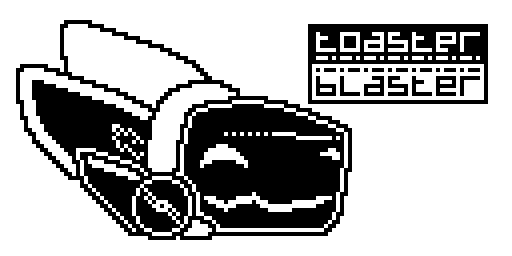

 
    

 
This is an LED control program for protogen helmets to be used with MAX7219 LED matrixes and ESP32 dev boards. 
<b>Custom build for powerstick synth</b> 

# Setup

## Hardware

The following hardware is required:
- S2 Mini microcontroller
- DFPlayer Mini MP3 Player
- Small SD Card for mp3 files
- MAX7219 LED Dot matrix modules (one 32x8 module cut in half or two 16x8 modules)
- Samsung powerstick vacuum cleaner (preferably broken)

## Wiring

### MAX7219 LED Dot matrix
MAX7219 can be daisy chained. Wire up displays in this order: 

- ESP32
1. Eye Left (16x8)
2. Eye Right (16x8)

 

| MAX7219 | S2 Mini |
| - | - |
| DIN | 36 |
| CS | 33 |
| CLK | 34 |

### DFPlayer Mini MP3 Player
| DFPlayer | S2 Mini |
| - | - |
| TX | 7 |
| RX | 9 |

Connect a speaker to SPK_1 and SPK_2 terminals. Copy contents of Sounds directory to an SD card and insert it into the module.

### Vacuum cleaner button
Connect to pin 6 on the microcontroller.  Configured as pullup, connect the other terminal to ground.

## Software setup
- You'll need [Visual Studio code](https://code.visualstudio.com) with the PlafromIO IDE extension installed. 
- Clone this project and add it in the PlatformIO menu (**PlatformIO -> PIO Home -> Projects & Configuration -> Add Existing**). This should set up a development environment and download all necessary dependencies.
- Press **PlatformIO: Build (Ctrl+Alt+B)** to build your project.
- Connect your microcontroller while holding the **O** button. Press **PlatformIO: Upload (Ctrl+Alt+U)**. Wait until the program starts uploading and release the button.
- Your microcontroller is now ready to use.

## Controls
Quickly tap the button to change brightness. Hold to play vacuum animation, release to stop, release early for error animation.

## Editing face bitmaps:
- Check the [Bitmaps directory](src/Assets/Bitmaps) containing images for eyes. 
- Images are converted from png to source code during the build process. Simply edit the images and rebuild (Ctrl+Alt+B).

## (todo) Quick configuration
- Important configuration constants can be found in [config.h](src/config.h)
- `setup()` function in [main.cpp](src/main.cpp) handles registering and initializing displays, peripherals, used transitions and overlays
- Debug messages DDEBUG an be enabled in [platformio.ini](platformio.ini)
  

# (todo) Contributing
  

# Credits
- [DFRobot/DFRobotDFPlayerMini](https://github.com/DFRobot/DFRobotDFPlayerMini)

# License
This program is licensed under [GNU Affero General Public License v3.0](LICENSE).